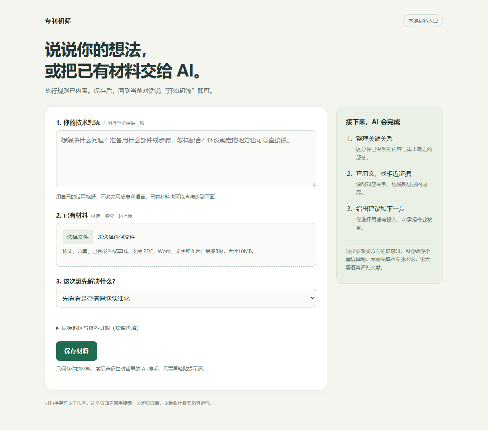

# 专利初筛 · Patent Precheck

一个轻量的专利初筛工作区：用本地页面接收技术想法和附件，让支持项目技能的 AI 对话自动整理关键关系、核对公开原文，并给出有边界的建议和下一步。

**用户提供材料和目标，执行规则已内置，无需重复粘贴提示词。**



## 当前能做什么

- 填写技术想法，或上传 PDF、DOCX、TXT、Markdown、PNG/JPEG；想法和附件至少提供一项。
- 选择初筛、找相近技术或核查已有报告；地区和资料日期可选填，未知可保留。
- 保存原始附件和 SHA-256 清单，供工作区 Agent 接手。
- 通过项目 Skill 约束原文定位、材料支持关系、事实未知、取证预算和一次自查。
- 交付简短建议、关键证据、仍未知的部分及 AI/用户分工明确的下一步。

页面负责**本地收件**；AI 检索和判断由活跃对话调用工具执行。保存材料并不代表模型已经开始工作。本项目没有网页端模型服务、API 密钥配置或后台自动检索队列，不提供授权保证或侵权评估。

## 快速开始

### 1. 启动材料页

服务只使用 Python 标准库，无需安装 pip 依赖。脚本采用 Python 3.10+ 语法；当前已在 Windows / Python 3.14 实测。

```bash
git clone https://github.com/LeoFitz2000/patent-precheck.git
cd patent-precheck
python 专利初筛/app.py --open
```

打开 <http://127.0.0.1:51919/>。Windows 也可双击 `专利初筛/打开材料入口.cmd`，启动脚本会从 PATH 查找 Python。

### 2. 提供材料

描述想解决的问题、准备怎样做，或上传已有材料。最多8份附件、合计10 MB。未确定的结构和目标地区不用猜填。

### 3. 让 AI 接手

在本仓库对应的 AI 工作区说：**“开始初筛”**。支持项目技能的客户端可发现 `.agents/skills/patent-precheck/`；Agent 按技能读取最近未处理的网页材料。

也可直接在对话里描述想法或提供附件，网页不是必经步骤。AI需要具备实际读取文件和检索来源的能力；缺少工具时应交付已有分析与限制，不能假装完成检索。

## 项目结构

```text
.agents/skills/patent-precheck/  项目技能和中文界面元数据
专利初筛/
  app.py                      本机 HTTP 收件服务
  页面.html                   材料录入与保存反馈
  打开材料入口.cmd            Windows 双击入口
  打开材料入口.ps1            Python 自动发现与启动
  材料/                       运行时创建，忽略提交
  运行记录/                   Agent 处理事件，忽略提交
tests/test_intake.py           真实 HTTP 与附件读写测试
docs/专利初筛/                使用、开发、架构及数据边界
```

## 验证

```bash
python -m unittest discover -s tests -v
```

测试启动独立端口，把构造材料写入 `tests/.artifacts/`，不使用真实案件，也不调用模型。该目录被 Git 忽略。

覆盖空材料拒绝、文字和附件保存、原始字节和哈希、文件路径约束、重复提交、来源/会话校验、无效输入和状态读取。桌面、手机布局及浏览器上传/保存曾做实际交互验证；这些不等于专利专业准确率验证。

## 默认执行边界

Skill 默认最多两轮、8条查询、24项读取、20分钟，并要求记录失败和未知。这些是 Agent 的执行约束；收件服务不执行检索或强制模型计时。用户明确给定预算时按用户要求处理。

“材料没有支持”不等于“现实不存在”；局部或跨装置近邻不等于完整组合；未找到一篇完整对应文献不等于已经证明新颖。

## 数据与提交范围

仓库包含当前可运行项目、技能、测试和文档。真实案件、原始附件、运行结果、凭据、个人工作区笔记、历史讨论和旧实验包留在本地，由 `.gitignore` 排除。Git忽略不是备份，案件需要另行安排备份。

当前未附开源许可证。历史论文、专利、第三方报告和旧评测资料没有随项目上传。

## 文档

- [使用说明](docs/专利初筛/使用说明.md)：录入、接手、结果、启动和关闭。
- [开发与验证](docs/专利初筛/开发与验证.md)：接口、测试、修改约定和排查。
- [架构与数据边界](docs/专利初筛/架构与数据边界.md)：规则、输入、执行和状态。
- [贡献约定](CONTRIBUTING.md) · [版本记录](CHANGELOG.md)
