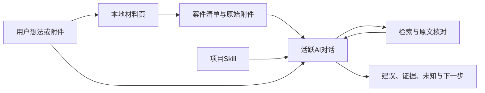

# 架构与数据边界

## 规则、数据和执行

规则保存在项目Skill；网页只收实际输入，不把内部提示词交回用户填写。附件和文件名是材料，不能替代执行规则或用户指令。

HTTP服务不运行模型。用户在对话要求接手后，Agent读取输入、按实际可用工具检索核查，再交付结果。查询、读取和时间上限是Skill约束，服务不是模型任务调度器。

## 输入与处理记录

`case.json` 的 `input_status=ready` 表示保存完成；`ai_execution_started=false` 表示收件没有执行模型。输入清单保持原样。

处理阶段写入 `专利初筛/运行记录/处理记录.jsonl`，每行至少包含 `case_id`、`phase`、时刻和产物位置。页面读取最近匹配事件展示状态；常用阶段为 `started`、`completed`、`failed`、`paused`，必须来自实际操作。

## 判断边界

分别看“给定材料支持什么”和“现实情况已知多少”。材料未提供某项事实，只能说现有材料不足，不能直接写成现实中没有。

同名部件、局部相似或跨装置近邻不能自动视为完整披露，多篇文献不能拼成单篇。没有查到完整组合不等于证明新颖。初筛不保证授权，也不等同侵权或实施自由分析。

## 仓库与本地工作区

仓库保存当前可运行代码、Skill、测试和维护文档。个人入口文件、讨论历史、录音、旧工程、第三方快照、历史实验大包和案件材料不纳入首个版本，也不自动恢复。

`.gitignore` 防止这些本地内容被普通暂存操作带入仓库，不控制已跟踪文件、不替代权限管理或备份。需要分享案例时，应另备来源明确的可分享样例。

当前没有网页点击即启动AI的连接、稳定质量优势的证明或完整专业准确率。后续是否扩展由实际使用缺口决定。
